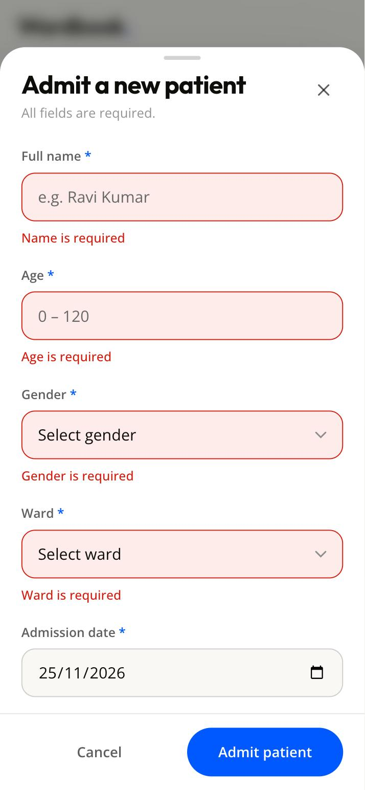

# Wardbook — Patient Admission Management

A web app for hospital staff to admit, track and discharge patients.

**Live app:** _LIVE_LINK_ (frontend and backend run on one URL)

| Desktop | Dark mode |
|---|---|
|  |  |

| Phone | Validation | Tablet |
|---|---|---|
|  |  |  |

## Tech stack

| Layer | Choice |
|---|---|
| Frontend | React 19 + Vite, plain CSS (no UI kit), lucide icons |
| Backend | Python 3.12, FastAPI, Pydantic (validation), SQLAlchemy |
| Database | PostgreSQL in production (data survives restarts), SQLite for local dev |
| Hosting | Vercel (React static + Python serverless function) with Neon Postgres. A Dockerfile and `render.yaml` also work for Render/Railway/Fly. |

## Features

- Add, edit and delete patients (delete asks for confirmation)
- List all patients: a table on desktop, cards on phone and tablet
- Filter by ward, department and doctor (the doctor list follows the chosen department)
- Search by name (debounced)
- Mark as discharged in one click, with Undo; re-admit later
- Tap the Total / Admitted / Discharged counters to filter by status
- Light and dark mode follow the system setting; respects reduced-motion

## Validation (frontend **and** backend)

| Field | Rule |
|---|---|
| Name | required, letters and single spaces only, max 60 |
| Age | required, whole number 0–120 |
| Gender, Ward, Department, Doctor | required, must be from the list; doctor must belong to the department |
| Admission date | required, not in the future (hospital time, IST) |

The backend returns `422` with a clear message for each field:

```json
{"message": "Age must be between 0 and 120",
 "errors": {"age": "Age must be between 0 and 120", "ward": "Ward is required"}}
```

## Run locally

Needs Python 3.10+ and Node 18+.

```bash
# 1. Backend (http://127.0.0.1:8000)
cd backend
python -m venv .venv && source .venv/bin/activate
pip install -r requirements.txt
uvicorn main:app --reload --port 8000

# 2. Frontend (http://localhost:5173), in a second terminal
cd frontend
npm install
npm run dev
```

The dev server proxies `/api` to the backend (see `frontend/vite.config.js`; change the port there if needed).
Data is stored in `backend/patients.db` until you set `DATABASE_URL`.

Run the API tests:

```bash
cd backend && pip install pytest httpx && pytest -q
```

## Deploy

**Vercel + Neon (what the live link uses)**
1. Import this repo in Vercel. `vercel.json` builds `frontend/` and serves `api/index.py` as the Python function.
2. Add a Postgres database (Storage → Neon). It sets `DATABASE_URL` / `POSTGRES_URL` for you.
3. Deploy. The table and 6 demo patients are created on first start.

**Render (or any Docker host)**: New → Blueprint → pick this repo. `render.yaml` creates the web service and a Postgres database and wires `DATABASE_URL`.

No passwords or keys are in this repo; the database URL comes only from environment variables.

## API

| Method | Path | Purpose |
|---|---|---|
| GET | `/api/options` | genders, wards, departments, doctors by department, today's date |
| GET | `/api/patients?search=&ward=&department=&doctor=&status=` | list / search / filter |
| POST | `/api/patients` | add (status starts as Admitted) |
| PUT | `/api/patients/{id}` | edit |
| PATCH | `/api/patients/{id}/status` | `{"status": "Discharged"}` or `"Admitted"` |
| DELETE | `/api/patients/{id}` | delete |

## Project layout

```
backend/main.py        FastAPI app: models, validation, routes
backend/test_api.py    API tests
frontend/src/App.jsx   list, filters, search, stats, delete dialog
frontend/src/PatientForm.jsx   add/edit form
frontend/src/validation.js     client-side rules (mirror of the backend)
api/index.py           Vercel entry that imports backend/main.py
```
