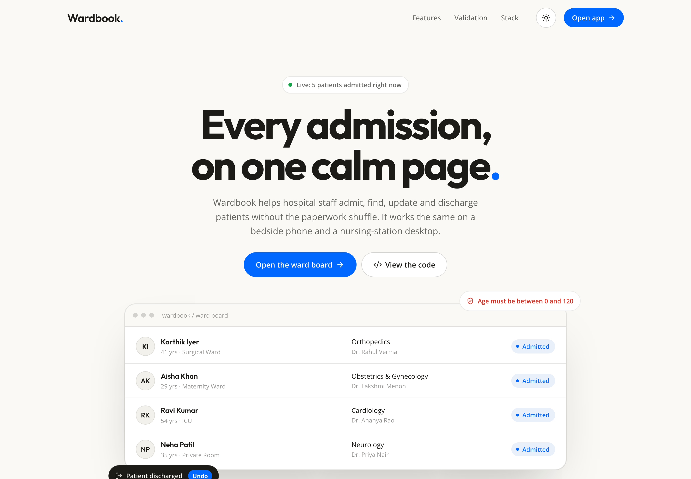
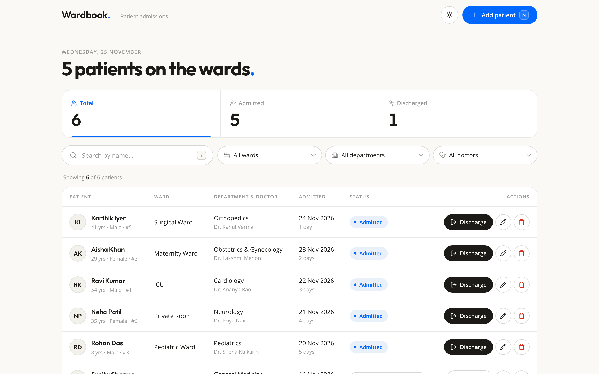
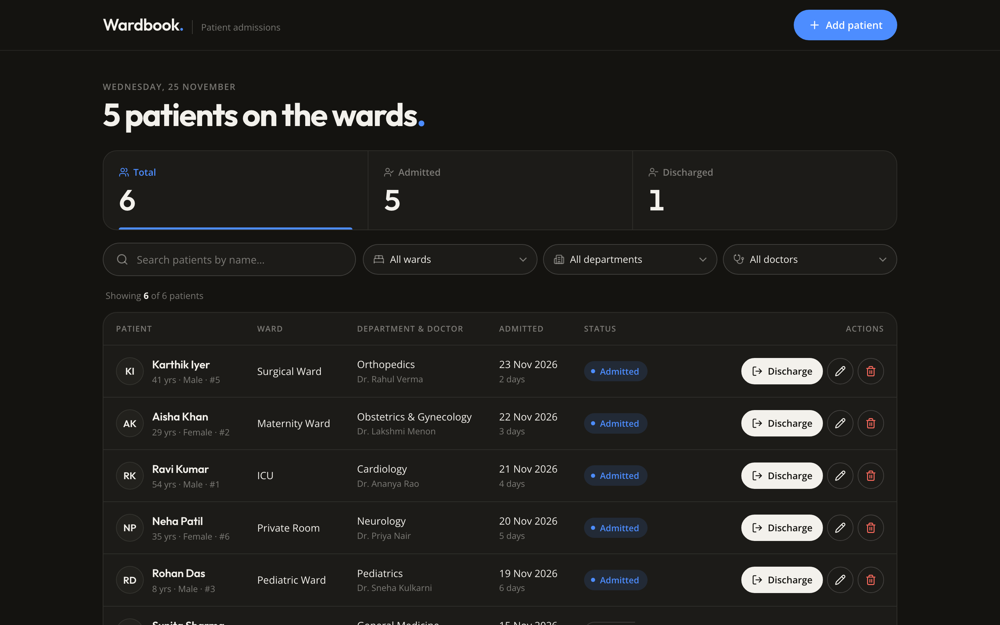
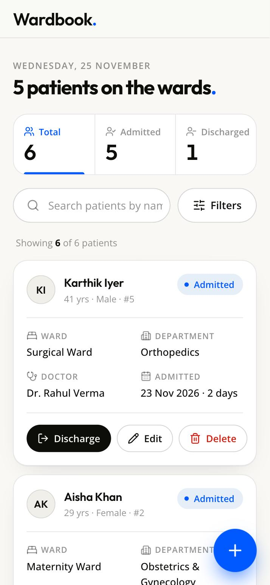
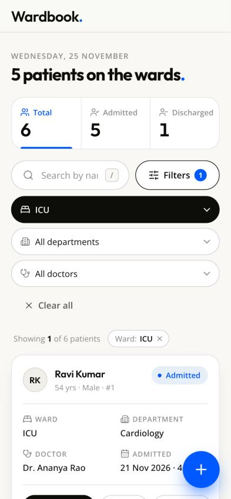
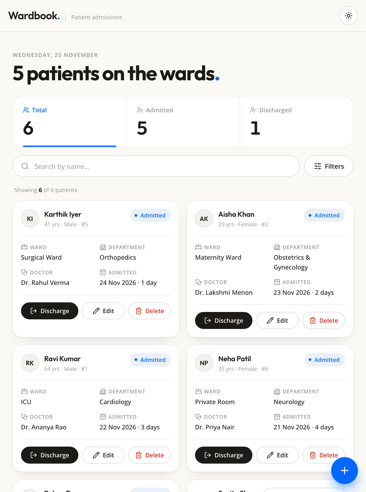
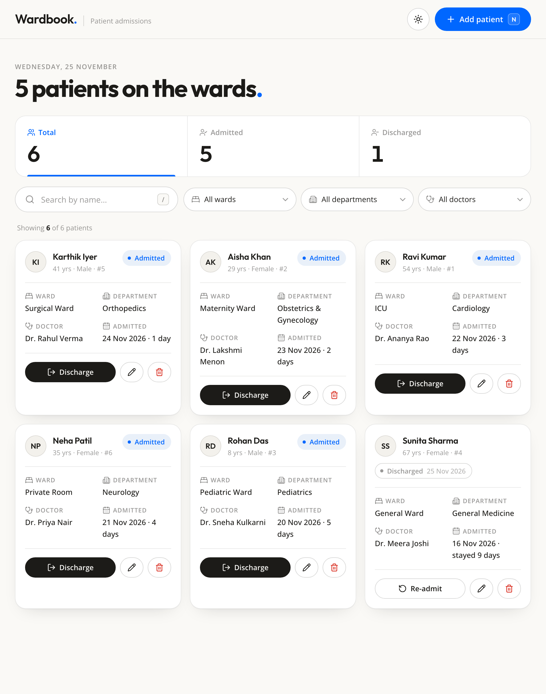

# Wardbook — Patient Admission Management

A web app for hospital staff to admit, track and discharge patients.

- **Live app:** https://wardbook-patient-admission.vercel.app/app (the ward board)
- **Landing page:** https://wardbook-patient-admission.vercel.app
- **Repo:** https://github.com/mdayan8/wardbook-patient-admission

Frontend and backend run on one URL; no login is needed.

| Landing page | Ward board (desktop) | Dark mode |
|---|---|---|
|  |  |  |

| Phone | Phone filters | Validation | Tablet | Small laptop |
|---|---|---|---|---|
|  |  |  |  |  |

## Requirements checklist

Every item below was tested on the live site (backend: 37 automated checks; frontend: driven through the real UI).

| Requirement | Where / how |
|---|---|
| Patient fields: name, age, gender, ward, department, doctor, admission date, status | `backend/main.py` table + form in `PatientForm.jsx` |
| 1. Add a patient | "Add patient" button (or `N`), new patients start as Admitted |
| 2. View all patients | `/app`: table ≥ 1180px, cards below |
| 3. Filter by ward, department, doctor | Three dropdowns (combine freely); `GET /api/patients?ward=&department=&doctor=` |
| 4. Search by name | Search box, case-insensitive, matches highlighted |
| 5. Edit a patient | Pencil button opens the form prefilled; same validation |
| 6. Delete with confirmation | Trash button → "Delete …? This can't be undone" dialog |
| 7. Mark as discharged | One click, records the discharge date, Undo in the toast |
| 8. Works on mobile, tablet, desktop | Checked at 360, 390, 768, 1024, 1180 and 1440px with no sideways scrolling |
| Validation in frontend **and** backend | `frontend/src/validation.js` and `PatientIn` in `backend/main.py` (same rules) |
| Backend rejects bad data with a clear message | `422 {"message": ..., "errors": {field: message}}` |
| React frontend | React 19 (Vite) |
| Backend not Node.js | Python (FastAPI) |
| Data survives restart | Postgres; a record was confirmed present after two redeploys |
| Public repo, live link, README with screenshots | This page |
| No passwords or keys in GitHub | Database URL lives only in Vercel environment settings; history scanned |
| No login required | Open the link and use it |

## Tech stack

| Layer | Choice |
|---|---|
| Frontend | React 19 + Vite, plain CSS (no UI kit), lucide icons |
| Backend | Python 3.12, FastAPI, Pydantic (validation), SQLAlchemy |
| Database | PostgreSQL (Supabase) in production, so data survives restarts and redeploys; SQLite for local dev |
| Hosting | Vercel: React static files + Python serverless function, one URL. A Dockerfile and `render.yaml` also work for Render/Railway/Fly. |

## Features

- Add, edit and delete patients (delete asks for confirmation)
- List all patients: a table on desktop, cards on phone and tablet
- Filter by ward, department and doctor (the doctor list follows the chosen department)
- Search by name: results update on every keystroke
- Filters and search run in the browser on the loaded list, so picking or clearing a filter updates instantly;
  saves, discharges and deletes update the list from the server's reply without a refetch
- Custom dropdowns (`Picker.jsx`): type-to-search for long lists, ↑/↓/Enter/Esc keyboard control, a check on the selected item,
  one-tap × to clear a filter, and a live count beside each option (e.g. "ICU 1") that reflects the other filters
- Doctors are grouped by department; in the form, picking a doctor first fills in their department
- Mark as discharged in one click, with Undo; re-admit later
- Tap the Total / Admitted / Discharged counters to filter by status
- Active filters show as removable chips; search matches are highlighted
- Keyboard shortcuts on desktop: `/` search, `N` new patient, `Esc` clear search
- Loading: skeleton rows shaped like the real list, a thin progress bar on refresh, spinners on save/delete
- Form: gender segmented control, Today/Yesterday date shortcuts, doctor list follows the department,
  errors appear inline as you type and the first invalid field gets focus on submit
- Light/dark toggle (sun/moon button) with a circular wipe; remembers your choice, defaults to the system setting
- Landing page at `/` with a live preview of the ward list; the ward board is at `/app`
- Respects reduced-motion settings

## Validation (frontend **and** backend)

| Field | Rule |
|---|---|
| Name | required, letters and single spaces only, max 60 |
| Age | required, whole number 0–120 |
| Gender, Ward, Department, Doctor | required, must be from the list; doctor must belong to the department |
| Admission date | required, not in the future (hospital time, IST) |

The backend returns `422` with a clear message for each field:

```json
{"message": "Age must be between 0 and 120",
 "errors": {"age": "Age must be between 0 and 120", "ward": "Ward is required"}}
```

## Run locally

Needs Python 3.10+ and Node 18+.

```bash
# 1. Backend (http://127.0.0.1:8000)
cd backend
python -m venv .venv && source .venv/bin/activate
pip install -r requirements.txt
uvicorn main:app --reload --port 8000

# 2. Frontend (http://localhost:5173), in a second terminal
cd frontend
npm install
npm run dev
```

The dev server proxies `/api` to the backend (see `frontend/vite.config.js`; change the port there if needed).
Data is stored in `backend/patients.db` until you set `DATABASE_URL`.

Run the API tests:

```bash
cd backend && pip install pytest httpx && pytest -q
```

## Deploy

**Vercel + Postgres (what the live link uses)**
1. Import this repo in Vercel (framework preset: Other). `vercel.json` builds `frontend/` and serves `api/index.py` as the Python function.
2. Add a Postgres database from Storage (Supabase or Neon). It sets `POSTGRES_URL` for you; any `DATABASE_URL` works too.
3. Deploy. The table and 6 demo patients are created on first start. Pushes to `main` redeploy automatically.

**Render (or any Docker host)**: New → Blueprint → pick this repo. `render.yaml` creates the web service and a Postgres database and wires `DATABASE_URL`.

No passwords or keys are in this repo; the database URL comes only from environment variables.

## API

| Method | Path | Purpose |
|---|---|---|
| GET | `/api/options` | genders, wards, departments, doctors by department, today's date |
| GET | `/api/patients?search=&ward=&department=&doctor=&status=` | list / search / filter |
| POST | `/api/patients` | add (status starts as Admitted) |
| PUT | `/api/patients/{id}` | edit |
| PATCH | `/api/patients/{id}/status` | `{"status": "Discharged"}` or `"Admitted"` |
| DELETE | `/api/patients/{id}` | delete |

## Project layout

```
backend/main.py        FastAPI app: models, validation, routes
backend/test_api.py    API tests
frontend/src/Landing.jsx  landing page at /
frontend/src/App.jsx   ward board at /app: list, filters, search, stats, delete dialog
frontend/src/ThemeToggle.jsx  light/dark switch
frontend/src/PatientForm.jsx   add/edit form
frontend/src/validation.js     client-side rules (mirror of the backend)
api/index.py           Vercel entry that imports backend/main.py
```
